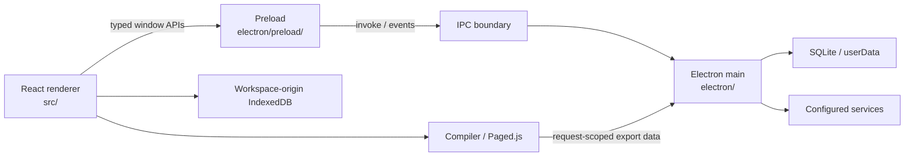

# Code Architecture

This document describes the current design of HighTex Desktop and the
boundaries that changes should preserve. It is an orientation guide, not a
replacement for the code, types, or tests. When implementation and this note
disagree, verify behavior in the source and update this document.

## System context

HighTex Desktop is an Electron application with three runtime responsibilities:

1. **Electron main process** owns application lifecycle, windows, filesystem
   access, SQLite, network integrations, and workspace selection.
2. **Preload** exposes a narrow API from the main process to renderer windows.
   It is the boundary between privileged desktop capabilities and UI code.
3. **Renderer** is a React application. It owns navigation, editing
   interactions, IndexedDB document drafts, document rendering, and
   user-facing feedback.



The renderer must not import Electron or Node.js APIs to perform privileged
work. The main process should not own React view state. IPC contracts connect
the two and should remain explicit, typed, scoped, and as small as possible.
See [Electron IPC](./electron-ipc.md) for the implementation workflow.

## Repository folder structure

The tree below shows the main source and documentation areas. It intentionally
omits individual files, generated output, dependencies, and assets so the
structure stays useful instead of becoming a second file listing.

```text
.
├── electron/                  # Electron main-process code
│   ├── main/                  # Startup and application lifecycle
│   ├── preload/               # Renderer API bridge
│   ├── handlers/              # IPC feature handlers
│   ├── service/               # Main-process services
│   ├── database/              # SQLite connection, models, and schema
│   ├── workspaces/            # Workspace registry, runtime, and migration
│   └── windows/               # Main, editor, and auxiliary windows
├── sharable-types/            # Contracts shared across process boundaries
├── src/                       # React renderer and document application
│   ├── components/            # Feature components
│   │   └── ui/                # Shared UI primitives
│   ├── context/               # Renderer-wide React providers
│   ├── hooks/                 # Reusable React hooks
│   ├── pages/                  # Route-level screens
│   ├── editor/                # Editor and document model
│   │   ├── chapter/           # Chapter model and graph/query logic
│   │   ├── document/          # Document lifecycle and draft behavior
│   │   ├── extensions/        # Tiptap extensions
│   │   ├── manager/           # Editor application events and commands
│   │   └── storage/           # IndexedDB persistence adapters
│   ├── compiler/              # Document-to-printable rendering
│   │   ├── builder/           # Static document sections and indexes
│   │   ├── engine/            # Rendering lifecycle and resolver order
│   │   ├── handlers/          # Paged.js handlers
│   │   ├── resolver/          # Content and DOM transformation passes
│   │   └── sheets/            # Printable front-matter sections
│   ├── forms/                 # Form generation and review logic
│   ├── locales/               # English and Indonesian messages
│   ├── types/                 # Renderer and global TypeScript contracts
│   ├── utils/                 # Shared renderer/domain helpers
│   └── workspaces/            # Workspace identity and renderer logic
├── tests/                     # Unit and service-level tests
│   └── integration/           # Opt-in Electron and end-to-end fixtures
└── docs/
    ├── contributors/          # Engineering and architecture notes
    └── users/                 # User-facing documentation
```

### Placement rules

- Keep code under the owning runtime: privileged operations in `electron/`,
  renderer behavior in `src/`, and shared contracts in `sharable-types/` or the
  appropriate `src/types/` module.
- Put domain behavior beside its domain. For example, editor persistence
  belongs in `src/editor/storage/`, not in a route component or a generic
  utility module.
- Put a screen that owns navigation and page composition in `src/pages/`;
  reusable visual controls belong in `src/components/`, with cross-feature
  primitives in `src/components/ui/`.
- Keep compiler passes in `src/compiler/` and preserve the distinction between
  builders, resolvers, and Paged.js handlers.
- Add tests under `tests/`, mirroring the behavior or contract being tested.
  Keep Electron-launching or external-service fixtures under
  `tests/integration/`.
- Add focused files to the existing domain folder before creating a new
  top-level directory. Create a new folder only when it represents a distinct,
  coherent responsibility with multiple related modules; avoid catch-all
  folders such as `misc`, `common2`, or duplicate `helpers` directories.
- Do not move or rename unrelated modules just to make the tree look uniform.
  Preserve established imports and boundaries, and update this guide when an
  intentional structural change is made.

## Runtime and window model

### Startup order

`electron/main/index.ts` acquires the single-instance lock, initializes the
workspace runtime, and only then dynamically imports the application modules.
This order matters: imported services may open stores during module
initialization, so workspace paths and identity must be set first.

`initializeWorkspace` reads the registry under the original Electron
`userData` root, determines whether legacy migration is required, and selects
the active workspace. After migration, Electron's `userData` path is set to the
active workspace directory before application services are prepared.

The main application then prepares core services, registers IPC handlers,
creates the main window, and processes queued file opens or deep links. Keep
startup work that depends on workspace identity after workspace initialization.

### Renderer window types

- **Main window** hosts workspace and application routes.
- **Editor windows** are opened per document. Their document ID is passed to the
  renderer as an additional process argument, and their routes are restricted
  to that document. Reopening an already open document focuses its existing
  editor window.
- **Print/render windows** load dedicated routes used to construct printable
  content and export requests.

These are different views of application services, not separate copies of the
document. Do not mount another editor route in an auxiliary window without
preserving document ownership, close guarding, and workspace scope.

## Workspace identity and data ownership

The workspace registry is stored at the stable application data root. A
workspace has a stable ID and a `hightex://profile.<id>` origin. The active
workspace's directory is used for Electron `userData`; the application browser
data root stays stable while the custom origin separates browser-origin
storage.

This gives each workspace its own local document database and main-process
storage context. Workspace switching is a controlled restart: editor windows
must pass their close/save guard, unrelated windows must close, the active ID
is changed, and the application relaunches. Pending file opens or links can
interrupt a switch instead of being silently applied in another workspace.

| Data                                                                    | Primary owner                                                | Scope                                                        |
| ----------------------------------------------------------------------- | ------------------------------------------------------------ | ------------------------------------------------------------ |
| Document metadata, chapters, images, references, aliases, and variables | Dexie `HighTexDB`                                            | Renderer origin / workspace                                  |
| Workspace registry and migration journal/backups                        | `electron/workspaces/`                                       | Stable application data root                                 |
| Main-process relational records such as local lecturers and snapshots   | SQLite services/models                                       | Active workspace user data                                   |
| Application configuration and desktop session state                     | Main-process config/session services exposed through preload | Active application/workspace context                         |
| Portable document content and its included profile                      | `.hightex` archive                                           | The exported document, independent of the current UI session |
| Unsaved chapter editor state                                            | Tiptap editor plus pending IndexedDB writes                  | Open editor document                                         |

Do not infer ownership of portable document identity from the logged-in user
or the active workspace. A change to workspace data placement, protocol origins,
or migration behavior must preserve existing user data and should be covered
by [workspace tests](./testing.md) and migration integration tests.

## Renderer design and state flow

`src/App.tsx` owns route composition. Layouts represent application chrome and
route contexts, while pages compose feature components. Shared visual
primitives belong in `src/components/ui/`; domain behavior belongs closer to
its feature or service instead of being embedded in a generic UI component.

Use the state mechanism that matches the data:

- **Component state/hooks** for transient UI state such as an open panel or
  current selection.
- **React context** for cross-cutting renderer state with an existing provider,
  such as configuration.
- **IndexedDB/services** for durable document and workspace data.
- **Typed preload APIs** for operations owned by Electron.
- **Typed application events** for existing cross-component editor
  notifications. These are notifications, not a replacement for durable
  storage.

Avoid creating a second source of truth for data already owned by a service or
database. When a component needs durable changes, call the domain API and let
the existing event/state update path refresh consumers.

## Editing and persistence lifecycle

1. An editor window is opened for one document ID.
2. `Document.warm()` loads its metadata, resolves the applicable workspace
   author profile, loads the document category, and prepares chapters.
3. Each chapter editor waits for prior writes and stored content before it
   becomes editable. This prevents placeholder content from overwriting the
   persisted chapter during initialization.
4. Tiptap updates are normalized and written through the chapter/storage
   boundary. Writes to the same chapter are serialized.
5. Before a save, export, close, or workspace switch that requires the latest
   draft, the main process can request a flush from the owning editor window.
   The renderer waits for pending document writes and replies with either a
   failure or a consistent archive snapshot.

Preserve this sequence when changing editor startup or autosave. In particular,
do not enable editing before the content has loaded, and do not report a
successful flush before pending chapter writes finish. See
[editor persistence](./editor-persistence.md) for the storage contracts.

## Import, export, and rendering

Import has two responsibilities: the importer package validates and parses
portable archive data; the desktop adapter prepares and installs that model
into the current workspace database. Export takes a read transaction over the
document and its related records, then serializes a portable archive. A local
draft and an archive are different representations with different lifecycles.

PDF rendering is renderer-side browser layout. The compiler pipeline resolves
document content and resources before Paged.js paginates it. Electron owns the
final desktop export operation and its request lifecycle. Keep asynchronous
image/font readiness, cancellation, and request-to-document association
intact. See [document rendering](./document-rendering.md).

## Cloud and other remote services

Remote access is optional and should not be required for ordinary local
editing. Main-process services own authenticated network requests and use the
configured server and captured session. The renderer requests domain actions
through preload and displays their typed results.

Cloud document identity, account/server scope, content fingerprints, and
conflict behavior are separate from local document storage. Do not use archive
byte equality as a substitute for semantic content comparison. See
[cloud document sync policies](./cloud-document-sync-policies.md) before
changing sync or fingerprint behavior.

## Design invariants

- Initialize workspace identity before importing modules that may open stores.
- Keep privileged capabilities in Electron main and expose narrow preload
  methods.
- Enforce sender, workspace, account, and document scope at the owning
  boundary; renderer types alone do not validate runtime input.
- Give each domain one durable source of truth; treat events as notifications.
- Preserve existing user data with explicit, repeatable migrations.
- Wait for asynchronous writes and required resources before claiming a save or
  render is complete.
- Keep portable archive content independent from whichever account or profile
  happens to be active.
- Surface failures and cancellation explicitly. Do not replace them with
  apparently successful empty results.
- Test boundary failures as well as the happy path.

## Change review questions

Before introducing a new abstraction or changing a boundary, ask:

1. Which process and module owns this behavior and its persistent state?
2. Is there already a typed service, hook, UI primitive, or IPC API for it?
3. What identity scopes the data: document, workspace, account, or archive?
4. Can a stale window, delayed request, retry, or app restart change the result?
5. Which old data must remain readable, and what is the migration/rollback
   behavior?
6. How will tests prove observable behavior without using personal data or a
   production account?

For code-specific guides and verification commands, use the
[contributor documentation index](./index.md).
