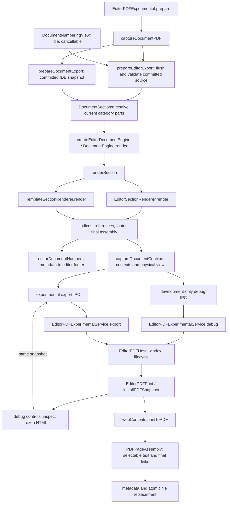

# Canonical document PDF flow

Editor toolbar, workspace PDF actions and Split now use this pipeline. The
`experimental:editor-pdf:*` namespace and existing class names are retained for
transport compatibility. Pagination is the editor's single mode; retaining these
names does not expose a second product paginator. Legacy PDF IPC is kept for
remaining compatibility consumers, including the deferred cloud viewer.

The renderer creates final document pages; Electron only prints the captured page
set. The entry point is `captureDocumentPDF` in [capture.ts](../../src/document-export/capture.ts).

Both PDF and the live pagination adapter now compile editable sections with
`ChapterLayoutCompiler`. `EditorSectionRenderer` only turns its compiled result into
ordered page descriptors. It has no separate measurement loop and receives no active
chapter. Portable image bytes are prepared once per resource owner, so published
HTML/effects do not depend on a measuring view's blob URL lifetime. The selected
editor state exposes its frozen result separately from the compatibility page plan;
source or dependency invalidation clears ready status without authoring content.

The renderer call is in
[render-section.ts](../../src/document-engine/render-section.ts): it selects
`renderers.editor.render()` or `renderers.template.render()` from `definition.kind`.
The concrete instances are wired in
[adapters/editor-document.ts](../../src/document-engine/adapters/editor-document.ts).
Templates never mount an editable editor. The native print route never replans
pages or reads draft content.

The approval and committee sheets use tighter blank spacing in template presentation
so they fit one page at the default geometry, including two advisors. Font sizes
and content remain unchanged; sheets are neither scaled nor clipped to force a
page count. Their shared markup exposes spacing variables with the existing legacy
values as defaults; only the experimental template stylesheet sets compact values.
Generated lists, bibliography and CV retain ordinary content fragmentation.

Source preparation is separate:

- [prepare-editor.ts](../../src/document-export/source/prepare-editor.ts) owns live-source readiness, saving waits,
  snapshot consistency. It does not copy live NodeView wrappers or reuse the
  selected editor plan. Both entry points compile the same immutable model.
- [prepare-document.ts](../../src/document-export/source/prepare-document.ts) owns document-only snapshot delivery
  without an active editor. Both use the same committed IDB reader.
- [document-render.ts](../../src/document-export/document-render.ts) owns section assembly, engine execution
  and disposal, shared by PDF capture and document numbering.
- [capture.ts](../../src/document-export/capture.ts) packages that render as a portable snapshot. It does
  not create a ZIP or call the legacy paginator.

`source/document-snapshot.ts` owns the shared export read: wait for queued autosave,
build the portable model, then fingerprint it. The stored records/workspace profile
read belongs to `editor/storage/document-render-snapshot.ts`, shared with the live
layout observer. The observer retains its own read and cancellation lifecycle;
export preparation does not make it wait for autosave. `DocumentExportInput` is
the explicit composition input. It owns data, not a live editor or measuring
surface, and has no placeholder `destroy()` method. Historical diagnostic helpers
read their own editor plan/geometry rather than adding them to product input.

Section policy precedence is stored group options → active group override →
explicit export group options. The prepared active group is already known; rendering
does not look it up again through a possibly missing section definition.

`EditorExportReadiness` owns one readiness wait: committed source binding, resource
waits, two-frame publication confirmation, deadline and event subscriptions.
Eligibility is read in one place before scheduling and confirming a candidate.
Completion, failure and cancellation share cleanup, which also aborts outstanding
font/image waits. A late resource completion cannot resolve a finished request.
Only a capture requested during composition may adopt its committed source;
other source/options/chapter changes remain retryable capture failures.

Product capture always uses canonical-context snapshots, including template-only
documents. `DocumentResources.prepare` embeds images and waits for fonts/images
before geometry is recorded; `serializePDFSnapshot` owns HTML, presentation,
fingerprint and the final resource/theme check. Historical materialized pages are
adapted by `tests/helpers/capture-materialized-pages.ts` into canonical contexts
before serialization. Their separate print wrapper stylesheet and transport v1/v2
are removed. The experimental API, print host and debugger have one v3 path;
the original legacy PDF API remains separate and unchanged. The snapshot format
marker is unrelated to the IndexedDB schema version.

Capture builds a context/local-page to physical-page index alongside the view
list. Target and link placement uses that index, retaining the first physical
owner if a view repeats. It does not assume contexts or local pages appear in
numeric order and does not change recorded geometry or native print batching.

`main.tsx` loads the internal print route directly, without importing `App` or its
editor/dashboard router. `EditorPDFPrint` loads inspection controls only in debug
mode. Normal application windows still load `App`; both paths use the same root
config provider and custom comment element. Print startup does not assemble or
replan document content.

Within one `DocumentResources` lifecycle, its `StylesheetSnapshot` owns CSS
serialization and revision checks; resource fetching stays with `DocumentResources`.
Capture/serialization accept the `DocumentResourceContext` contract, while template
and chapter renderers depend only on asset resolution and presentation identity
respectively. Repeated style requests reuse captured
CSS/font data only while stylesheet identities and rule revisions match. Concurrent
requests share one capture. A failed capture clears its candidate state; a later
request rebuilds it. The final stylesheet-change guard remains in place, and no
stylesheet cache is shared across documents or export jobs.

PDF images preserve the native renderer's decoded pixels. The user explicitly
accepted larger files rather than JPEG recompression or downsampling. WebP sources
can occupy more space when Chromium stores their decoded pixels with PDF Flate
encoding. A local predictor experiment saved only 1.76% on the supplied document
and added 8.3 seconds; it is not an enabled export stage.

The editor footer receives final labels from [document-numbering.ts](../../src/document-export/document-numbering.ts).
It uses the same document assembly and `numberDocument` as PDF export, including
preceding sections, generated indices and appendix resets. It does not print or
package a PDF. The pagination view debounces this work after the active chapter's
layout settles and cancels it on source/layout changes, navigation or disable.
Other chapters use read-only views. This computation never writes source, changes
selection/history or activates another chapter. Numbering pending/error is separate
from local layout readiness, so it cannot create an export readiness dependency.
Pending state may retain the preceding labels; initial labels stay empty until
the document result is available. `DocumentNumberingView.readyState` owns the shared
start conditions used by scheduling and refresh, including the opt-out. Invalidation
and stop cancel through one pending-work cleanup; publication retains ownership
until the job's finally block. A failed render shows a numbering status instead
of inventing local offsets. `documentNumbering: false` is for isolated diagnostics.

`PaginationOptions.sections` supplies introduction/content/appendix policies to
both the live geometry and complete document assembly. `section` overrides the
selected chapter's group; explicit export options take final precedence. Options
are engine configuration, without a new persistent settings UI.

The main/renderer transport contract lives in
[shared/editor-pdf-contract.ts](../../shared/editor-pdf-contract.ts), with DTOs
in `sharable-types/editor-pdf-experimental.d.ts`. The shared runtime module has no
DOM, editor, storage or Electron imports. Main imports it directly and does not
import renderer code for this PDF service. Other pre-existing cross-folder main
imports are outside this feature's boundary migration.

Validation has explicit owners. IPC validates payload shape, size and identity;
source preparation guards async changes to its frozen revision/resources;
canonical rendering resolves content fallbacks and plans image fitting/placement;
the print host loads portable resources and installs the captured layout; main verifies the native
page count and replaces the chosen file atomically. Native context selection and
page assembly live in `printProjectedPages`; metadata and file replacement do not
share its page loop. Main validates a snapshot
once per public entry, including direct `generate()` calls. These are runtime
correctness boundaries. Glyph equivalence, list-marker audits, style baselines
and PDF coordinate comparisons live in the native test fixtures.

`EditorPDFSnapshotError` identifies a transport failure with `path`, `reason` and
a bounded `received` description. Its message contains those fields too, because
Electron invoke errors do not retain custom properties. Large HTML and asset data
are described by size rather than copied into the message. Section continuity,
context/page ownership, destination IDs and bounds report their exact indexed
path. Validation stops at the first invalid dependency.

Image-boundary audits and reconstructed-box comparisons are test fixtures, not
production export gates. `tests/helpers/image-placement.ts` and
`tests/helpers/print-presentation.ts` own those oracles. Native export must not
reject a compiled document because an audit rectangle exceeds a recorded page
or differs from reference coordinates. Snapshot presentation metadata remains
in the transport for compatibility and diagnostic comparison; it does not choose
page breaks or decide whether native printing starts.
Page selection only moves the selected context/chrome and checks the request's
fingerprint/index; it does not scan all document boxes on every page. Main returns
selection errors explicitly across executeJavaScript so Chromium's generic
execution failure cannot hide the original message. Native print failures identify
the physical page, section, context and local page.

Fixtures retain image overflow diagnostics with source ranges and asset IDs.
Actual resource readiness, cancellation, source-revision ownership, transport
structure, native failures and atomic-file handling retain their production owners.

Editable sections retain their full paragraph/list/table context. Physical pages
select a fixed viewport into that context; text is not reshaped in independent
line fragments. `SectionViewport` strips editor UI and preserves content geometry.
`installPageViewport` installs the captured presentation and never replans. Debug
selects one physical page. Export selects up to four consecutive views from the
same canonical context and prints one native strip, bounded to 12,000 CSS pixels
of paper height. These are internal batch-size limits, not content/page limits or
user acceptance targets. Further pages continue in another batch. Different
contexts always start a new batch; single-view templates retain their own styles.

`PDFPageAssembly` crops each native strip into physical vector pages using PDF
form bounding boxes. It retains selectable text, shares copied font/image resources,
clips external URI annotations to their physical page and rebuilds internal links
against final destinations. Blank native strips produce blank physical pages.
It returns the assembled `PDFDocument`; the service applies metadata and serializes
it once. No save → reload → second save of the complete document is needed.
The compiler, snapshot layout and source are unchanged by batching. Repeated table furniture remains
the existing planner's responsibility. `PageFragments` and its fragment/list/table slicing helpers now live under
`tests/helpers/legacy-pagination/`, solely for historical diagnostic fixtures.
Production source-readiness text capture belongs to `chapter/rendered-text.ts`.

Editor controls have an explicit `data-editor-ui` boundary and are non-editable.
`editorNonContentSelector` excludes them from layout copies, fragment copies and
continuation furniture. Mutations inside these controls do not invalidate content
measurement. Hover/focus decoration uses outlines or absolute overlays, preserving
content width/height. The figure outline and heading hint are scoped to the live
editable root, so hovering the debug pages cannot reveal editor affordances.

In development, **Debug HTML** captures the same complete document as export and
opens it through the same print host. DevTools opens for inspection. The debug
window's export action submits that frozen snapshot to the existing export IPC;
later source edits do not alter it. Inspection itself neither prints nor opens a
save dialog. The toolbar lives outside the page set and is hidden in print media.
The UI is gated by `import.meta.env.DEV`; main rejects debug requests in packaged
applications. Closing/canceling inspection releases its IPC listeners and window.

The window lifecycle is owned by
[EditorPDFHost](../../electron/windows/editor-pdf-host.ts): request/frame binding,
ready handshake, timeout, cancellation and cleanup. The service owns snapshot
validation, native PDF metadata and atomic file saving. The internal route is
[EditorPDFPrint](../../src/pages/editor-pdf-print.tsx), shared by print and debug;
there is no separate preview renderer or paginator. `captureEditorChapterPDF` is
a test helper under `tests/helpers/`, not an alternate product capture path.

Inspection waits on the host's failure channel as well as normal window closure.
Closing an open debug window completes inspection; a crash, abort or readiness
failure rejects through the same host cleanup and report path as export. There is
no separate unobserved close listener masking renderer failures.

The deadline follows the existing export-timeout setting. A timeout reports its
configured duration and the current operation: HTML readiness, physical page
selection/printing (with section, context and local page), or final PDF/link
assembly. Large documents may reach that configured deadline while still making
progress; no partial file replaces the selected destination.

Export feedback works on the first run without timing history. The experimental
capture UI counts sections from the engine's `start` and `section.after` events.
A section contributes once even when index convergence renders it again; the
current section title stays visible alongside the processed/total count. This
count describes processed sections, not a percentage of the whole export.
The experimental
service emits request-scoped `EditorPDFProgress` events for choosing a destination,
loading the print host, printing, assembling and writing. `completedPages` advances
only after native bytes have been received and the strip has been assembled; it
does not represent a time percentage. A native call has no invented intermediate
percentage. The preload subscription filters by request ID and returns its cleanup.

`useDocumentPDF` owns the monotonic elapsed timer from capture through completion,
including time spent choosing a destination. The last save/cancel duration remains
visible. There is no predicted completion time or history-based estimate.
Cancel keeps the action busy until the request settles, aborts capture and the
main-process job, and closes its hidden print window. Navigation/unmount releases
the progress listener; cancelled or obsolete jobs cannot update the next request.
The existing atomic-file boundary remains responsible for preventing a partial PDF
from replacing the destination.

`PDFRequestStatus` is the shared, non-modal export card for editor and workspace.
It shows layout, PDF creation and save stages; its meter uses section/page counts
only within the current stage. The saved filename and open action remain until
dismissed. Errors show a brief message with collapsible details, while additional
diagnostics retain source navigation. Retry captures the current source using the
previous request's options, including watermark. The request hook owns that state;
the card does not start another export lifecycle or inject capture-time modal CSS.

Run `tests/integration/editor-pagination-ui.cjs` with isolated Electron to check
hover/selection/menu geometry and the debug-snapshot-to-native-PDF path. These
checks cover their recorded fixture; broader visual list defects require their
own reproduction and must not be declared resolved from page-count equality.

The normal editor toolbar contains pagination status, the primary PDF action and
an icon button opening the application's Popover. Disable, feedback, retry when
applicable, and development HTML inspection live in that menu; Escape closes it
and restores focus to its button. Diagnostics use the application's Collapsible
and keep their source navigation. Progress, warnings and errors appear when relevant.
Status follows capture, save or open-inspection phases.

The debug window separates the scrollable document canvas from its toolbar and
navigation sidebar. Physical page navigation, section jumps and internal document
links select views from the frozen snapshot; the sidebar distinguishes physical
pages from printed labels. On narrow windows it moves below the canvas. The section
list scrolls independently and long titles truncate without overlapping snapshot
identity or help. Identity uses Collapsible rather than native details/summary.
The panel owns a scoped stylesheet, mounted after snapshot installation removes
application styles. Inspection chrome never enters the snapshot or native PDF.

Its Inspector button uses the existing application inspection bridge and targets
the visible `[data-print-viewport]`. Hidden context-bank fragments must not supply
inspector coordinates.
The debug host handles only its own frame. Native right-click Inspect
Element and F12 / Cmd+Alt+I / Ctrl+Shift+I are installed and released with the host.
Inert attributes are removed only from the inspection DOM after installation;
otherwise Chromium hit-testing targets the inert ancestor instead of page content.
The frozen snapshot and native print DOM retain their original state.

Reference authority is `ChapterGraph.extractFromContent`, with document-wide
equation numbering applied in supplied chapter order. Opening a chapter recounts
its source into memory rather than trusting persisted graph numbers or writing
source. Snapshot rendering performs the same extraction. Serialized reference
`label` / `data-label` values do not override those results. The generated text is
formatted last; it is not parsed back into a number. Deleted targets receive the
red `Gambar ?` / `Tabel ?` fallback and emit a warning without blocking export.

Editor/PDF equivalence must compare the visible editor, canonical print DOM and
native PDF bytes. Passing a fixture does not certify the complete content/editing
matrix, resource invalidation, performance or full human corpus acceptance.

The application supplies a workspace-local, bounded `SectionLayoutCache` to both
editor and document compilation. It retains published data, never a measuring
view. Each consumer parses its own canonical context, so index/reference assembly
cannot mutate another consumer or the cached result. Source/options/presentation
identity must match; resource identity includes only the images, citations,
variables, equation numbers and reference labels/owners consumed by the chapter.
An edit elsewhere does not invalidate a chapter that does not depend on it.

Template column copies keep off-viewport content for native layout. Internal PDF
link annotations intersect the actual `.document-template-viewport`; a hidden next
column does not acquire a clickable rectangle in the paper's reserved margin.
Content remains intact and the transport's destination/bounds checks remain active.

Development adds HTML inspection to the same options Popover. Export has no strict
mode. Recoverable content problems keep
their fallback and emit warnings. Broken ordinary links use `#`; references use the
red kind + `?` label. Selecting a broken reference focuses its source. Missing or
corrupt images share a portable placeholder between the live editor, canonical
layout and print host, with repair controls outside measured content. Input IDs,
source JSON and stored assets are not repaired by capture. Any future blocking
scanner policy belongs to a separate pre-compile stage.

Native batch-size experiments must include fractional physical geometry such as
A4. An integer CSS stride can conceal native paper/crop rounding differences:
compare page rasters and external link coordinates, not only extracted text and
page count. The default remains four views with the existing 12000px strip cap;
a larger batch is not an accepted optimization merely because an integer-size
fixture passes. `HIGHTEX_NATIVE_BATCHES=1` is an opt-in comparison experiment, not
a passing release acceptance check for eight-view output.

Viewport selection keeps the current canonical context mounted for consecutive
batches of that section. A context returns to the bank only when changing sections;
page chrome still follows each selected view. The print stylesheet is replaced only
when the physical paper dimensions change. This avoids subtree/style invalidation
without changing batch limits, crop geometry or recorded pagination. Timing claims
must separate capture, host startup, native print calls and assembly; reducing CSS
work alone does not establish a substantial whole-document export speedup.
